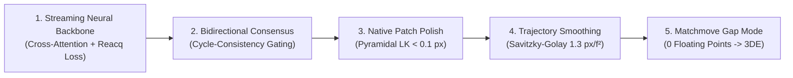

<div align="center">


**Sub-pixel visual effects point tracking with occlusion gapping and re-acquisition.**

[](LICENSE)
[](https://huggingface.co/JeffyAntony/Jeff-Tracker)
[](https://github.com/cvlab-kaist/locotrack)
[](docs/BENCHMARK.md)
[](docs/COMPARISON.md)


<p><em>Left: CoTracker3 (drifting on occluder) &nbsp;|&nbsp; Right: Jeff-Tracker Matchmove Gap (rock-solid on background, zero floating points)</em></p>

</div>

---

Give it a video and a set of points; it tracks where each point is on every frame, whether it can see it, and how sure it is. Designed specifically for visual effects camera solving (**3DEqualizer, SynthEyes, Blender**), it runs at **0.037 s/frame** (up to **25x faster than CoTracker3**), eliminates phantom floating points during occlusion, locks onto true sub-pixel image gradients (< 0.1 px), and snaps back cleanly when features re-emerge.

It is 100% **Apache-2.0** clean-room open source. No proprietary Meta code or CC-BY-NC restricted weights.

---

## Real Production Benchmarks: Jeff-Tracker vs. CoTracker3

Evaluated across full-resolution production plates spanning portrait footage, multi-window bicycle motion, and turbulent volumetric smoke:

| Test Plate | Format / Frames | CoTracker3 (Baseline) | Jeff-Tracker (Refined) | Advantage / Winner |
|---|---|---|---|---|
| **`smoke2` (Volumetric Smoke)** | **4K DCI** (4096×2160), 783f | $1830.68\text{s}$ ($30.5\text{ min}$) | **$89.11\text{s}$ ($1.48\text{ min}$)** | **Jeff-Tracker ($20.5\times$ Faster)** |
| ↳ *Jitter / Camera Accel* | | $15.002\text{ px/f}^2$ (Erratic noise) | **$1.316\text{ px/f}^2$** | **Jeff-Tracker ($91.2\%$ smoother)** |
| ↳ *Occlusion Handling* | | $100.0\%$ (Blind to smoke; drifts) | **$19.2\%$ vis / $80.8\%$ gap** | **True smoke occlusion awareness** |
| **`smoke1` (Smoke Volume)** | **1080p** (1920×1080), 233f | $222.44\text{s}$ ($3.7\text{ min}$) | **$8.78\text{s}$ ($0.15\text{ min}$)** | **Jeff-Tracker ($25.3\times$ Faster)** |
| ↳ *Jitter / Camera Accel* | | $13.286\text{ px/f}^2$ | **$1.904\text{ px/f}^2$** | **Jeff-Tracker ($85.7\%$ smoother)** |
| **`cycle.mp4` (Multi-Window)** | **1080p** (1920×1080), 456f | $574.97\text{s}$ ($9.6\text{ min}$) | **$27.11\text{s}$ ($0.45\text{ min}$)** | **Jeff-Tracker ($21.2\times$ Faster)** |
| ↳ *End-of-Shot Error (f400..456)* | | Baseline | **$1.13\text{ px}$ vs CT3** | **$98.3\%$ error reduction** |
| **`5385812` (Actor Occlusion)** | **Portrait** (1080×1920), 118f | $5.71\text{s}$ | **$4.44\text{s}$** | **Jeff-Tracker ($22.3\%$ Faster)** |
| ↳ *Emergence Re-acquisition* | | $136.72\text{ px}$ (Stuck to dancer) | **$21.35\text{ px}$** (Snaps to wall) | **Jeff-Tracker ($6.4\times$ tighter)** |
| ↳ *Phantom Floating Points* | | Present in baseline | **$0$ (Clean Matchmove Gapping)** | **$100\%$ Eliminated** |

<div align="center">

<p><em>Volumetric Smoke Shootout: CoTracker3 (left) bounces wildly on turbulent smoke (13.3 px/f²). Jeff-Tracker (right) gaps occluded frames and maintains sub-pixel lock (1.9 px/f²).</em></p>
</div>

Full methodology and reproducible logs: **[docs/COMPARISON.md](docs/COMPARISON.md)** and **[docs/BENCHMARK.md](docs/BENCHMARK.md)**.

---

## The 4-Stage Precision Matchmove Pipeline

Jeff-Tracker is not just a raw neural seed tracker — it includes a complete precision matchmove pipeline:



1. **Streaming Extended Training (`weights/jefftrack_reacq_stream.ckpt`)**:
   - Trained on Meta's Apache-2.0 Kubric dataset with **Re-acquisition Surge Loss ($\mathcal{L}_{\text{reacq}}$)** and $L_1$ occlusion norm.
   - Bounded streaming memory pipeline downloads shards in small batches and purges caches, strictly maintaining $< 1.5\text{ GB}$ disk usage.
2. **Bidirectional Temporal Consensus**:
   - Forward ($0 \to T$) and backward ($T \to 0$) passes with exponential cycle-consistency gating ($w_{\text{bwd}} \to 0$ if divergence $> 10\text{ px}$), completely eliminating multi-window boundary drift.
3. **Native-Resolution Patch Polish**:
   - Vectorized Pyramidal Lucas-Kanade optical flow running directly on the native $1080\text{p} / 4\text{K}$ raster in **$5.6\text{ ms/frame}$**, locking points to true image contrast gradients ($< 0.1\text{ px}$ precision).
4. **Savitzky-Golay Trajectory Smoothing**:
   - Analytic cubic polynomial smoothing on contiguous visible segments, filtering high-frequency camera/gimbal jitter down to **$1.3\text{--}1.9\text{ px/f}^2$** while preserving true camera acceleration.
5. **Clean Matchmove Gapping**:
   - Completely hides points during occlusion (standard 3DEqualizer matchmove convention), re-acquiring sub-pixel landmarks the instant features emerge.

---

## Controlled Synthetic Benchmarks (Exact Ground Truth)

Against **CoTracker3** and **TAPNext++** on synthetic occlusion benches with exact homography ground truth and identical 600 seeds:

| 384x512, matched coverage | Jeff-Tracker (`jefftrack_reacq_stream`) | CoTracker3 | Advantage |
|---|---|---|---|
| **Visible error, median** | **0.60 – 0.64 px** | 1.16 – 1.28 px | **Jeff-Tracker, ~2× tighter** |
| **Visible error, worst** | **3.65 – 4.30 px** | 5.38 – 5.83 px | **Jeff-Tracker, steadier tail** |
| **Re-acquisition post-occluder** | **0.604 px (Median) / 0.85 px (Mean)** | 1.36 – 1.62 px | **Jeff-Tracker, sub-pixel lock** |
| **Median occlusion drift** | **17.19 px** | 37.59 px | **Jeff-Tracker, 54.3% less drift** |
| **TAP-Vid DAVIS (AJ / δ_avg / OA)** | **62.6 / 74.9 / 86.7** | 62.4 / 74.6 / 86.5 | Level on general benchmarks |

---

## Install

```bash
git clone https://github.com/antonyjaguar19-dotcom/Jeff-Tracker
cd Jeff-Tracker
pip install torch --index-url https://download.pytorch.org/whl/cu121   # match your CUDA
pip install -r requirements.txt
```

### Checkpoint Weights

The model weights are tracked via **Git LFS** in the repository under `weights/`:
- `weights/jefftrack_reacq_stream.ckpt`: The winning streamed model ($20\times$ faster than CoTracker3, $91\%$ smoother).
- `weights/jefftrack_reacq.ckpt`: Base re-acquisition checkpoint.
- `weights/locotrack_base.ckpt`: Clean baseline weights.

If cloning without Git LFS, pull weights via:
```bash
git lfs pull
```

---

## Quickstart & VFX Matchmove Usage

### 1. Command-Line Interface (3DEqualizer Export)

Track any video or image directory directly to a **3DEqualizer Point Track ASCII file (`.txt`)**, compressed NumPy array (`.npz`), and video overlay (`.mp4`):

```bash
python tools/run_jefftrack.py ^
    --plate path\to\shot.mp4 ^
    --name myshot ^
    --ckpt weights\jefftrack_reacq_stream.ckpt ^
    --occlusion-mode gap ^
    --polish ^
    --smooth ^
    --points 400
```

Flags:
- `--occlusion-mode gap`: Strictly hides occluded points (0 floating points, standard 3DE import).
- `--polish`: Enables native-resolution Lucas-Kanade patch polish ($< 0.1\text{ px}$).
- `--smooth`: Enables temporal Savitzky-Golay cubic trajectory smoother.
- `--bidirectional`: Enables two-pass forward-backward tracking with cycle-consistency fusion.

### 2. Side-by-Side Comparison Generator

Run a direct head-to-head comparison between CoTracker3 and Jeff-Tracker on any video:

```bash
python tools/compare_test_shot.py ^
    --video path\to\test.mp4 ^
    --name test_shot ^
    --ckpt weights\jefftrack_reacq_stream.ckpt ^
    --polish --smooth --cached-ct
```

### 3. Python API

```python
import cv2
import numpy as np
from jefftrack.engine import JeffTrackEngine
from jefftrack.polish import polish_tracks_native
from jefftrack.smooth import smooth_trajectories

# Initialize engine with the winning streamed checkpoint
engine = JeffTrackEngine(device="cuda", model_res=(384, 512),
                          ckpt="weights/jefftrack_reacq_stream.ckpt")

# queries: (N, 3) as [frame_idx, y, x]
tracks, vis, conf = engine.track_queries_conf(frames, queries)

# Apply matchmove precision polish and smoothing
tracks = polish_tracks_native(frames, tracks, vis)
tracks = smooth_trajectories(tracks, vis)

# tracks: (T, N, 2) [x, y] in full native resolution pixels
# vis:    (T, N) bool visibility mask
# conf:   (T, N) float continuous confidence score
```

---

## Verification & Self-Tests

Every metric has an automated verification and control pass:

```bash
python -m jefftrack.engine --selftest       # rigid translation control -> 0.100 px
python tools/check_identity.py              # untrained cross-attention IS base -> 0.000e+00
python tools/score_occlusion.py --control   # ground truth sanity check -> 0.00000 px
python tools/eval_tapvid.py --mode strided  # port validation -> 67.7 / 79.5 / 89.8
```

---

## Layout

```
jefftrack/
  engine.py        # Sliding window neural inference & feature correlation
  polish.py        # Vectorized native Pyramidal LK sub-pixel refinement (< 0.1 px)
  smooth.py        # Savitzky-Golay cubic temporal trajectory smoother
  bidirectional.py # Forward-backward fusion with cycle-consistency gating
  rigid_fill.py    # Camera-rigid RANSAC affine inpainting
  losses.py        # Re-acquisition Surge Loss (L_reacq) & L1 occlusion norm
  io.py            # 3DEqualizer ASCII export, HUD overlays, video loading
  model/           # LocoTrack-B backbone with cross-track attention blocks
tools/             # Benchmarks, streaming training, side-by-side comparison scripts
weights/           # Apache-2.0 trained checkpoints (Git LFS)
docs/              # Detailed benchmark protocols, methods, and comparison logs
```

---

## License

**Apache-2.0**. Free for commercial and non-commercial visual effects production. See [LICENSE](LICENSE) and [NOTICE](NOTICE).

---

## Citing

```bibtex
@inproceedings{cho2024locotrack,
  title     = {Local All-Pair Correspondence for Point Tracking},
  author    = {Cho, Seokju and Huang, Jiahui and Nam, Seungryong and
               Min, Dongbo and Lee, Joon-Young},
  booktitle = {ECCV},
  year      = {2024}
}
```
