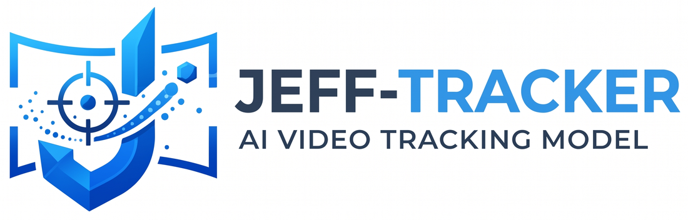
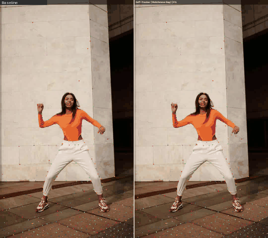
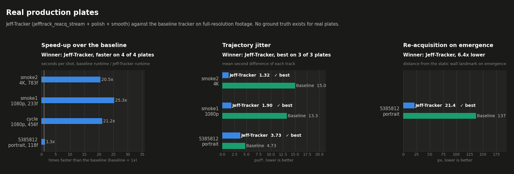
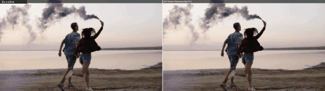
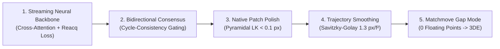
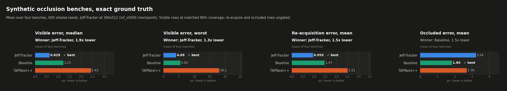
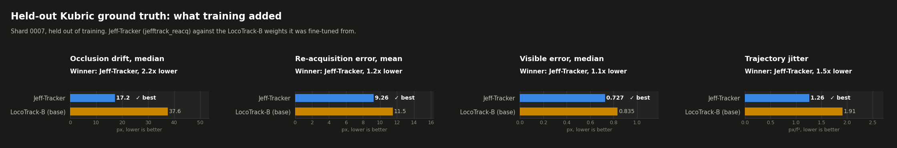

<div align="center">



**Sub-pixel visual effects point tracking with occlusion gapping and re-acquisition.**

[](LICENSE)
[](https://huggingface.co/JeffyAntony/Jeff-Tracker)
[](https://github.com/cvlab-kaist/locotrack)
[](docs/BENCHMARK.md)
[](docs/COMPARISON.md)


<p><em>Left: baseline tracker (points drift onto the moving actor) &nbsp;|&nbsp; Right: Jeff-Tracker in Matchmove Gap mode (stays on the background, no floating points)</em></p>

</div>

---

Give it a video and a set of points; it tracks where each point is on every frame, whether it can see it, and how sure it is. Jeff-Tracker is built for visual effects camera solving (**3DEqualizer, SynthEyes, Blender**). It runs at **0.037 s/frame** on production plates, up to **25× faster than the baseline tracker** we compare against. It gaps points while they are occluded instead of leaving phantom floating points, refines visible points to the native-resolution image gradient, and re-acquires features cleanly when they reappear.

Jeff-Tracker is a fine-tune and extension of **[LocoTrack-B](https://github.com/cvlab-kaist/locotrack)** (KU-CVLAB, ECCV 2024). LocoTrack's backbone and released weights are the starting point. On top of them this project adds a cross-track attention block, re-acquisition and occlusion training objectives, streaming Kubric training, and a four-stage matchmove precision pipeline. Everything in the chain is **Apache-2.0**: code, base weights and training data. See [NOTICE](NOTICE) and [docs/LICENSES.md](docs/LICENSES.md).

---

## Who it is compared against

| Name used here | What it is |
|---|---|
| **Baseline** | A widely used offline transformer point tracker, run unmodified at its default offline settings from a separate local install. It is distributed under a non-commercial licence, so none of its code or weights are included or redistributed here. |
| **LocoTrack-B** | The base model Jeff-Tracker is fine-tuned from (Apache-2.0). Every gain below that is reported against it is a gain this project added. |
| **TAPNext++** | Google DeepMind's tracker (Apache-2.0), used as a second reference on the synthetic benches. |

---

## Real Production Plates: Jeff-Tracker vs. Baseline

Full-resolution production plates: portrait footage, multi-window bicycle motion, and turbulent volumetric smoke. Jeff-Tracker runs `weights/jefftrack_reacq_stream.ckpt` with native patch polish and trajectory smoothing.

| Test Plate | Format / Frames | Baseline | Jeff-Tracker (Refined) | Result |
|---|---|---|---|---|
| **`smoke2` (Volumetric Smoke)** | **4K DCI** (4096×2160), 783f | $1830.68\text{s}$ ($30.5\text{ min}$) | **$89.11\text{s}$ ($1.48\text{ min}$)** | **$20.5\times$ faster** |
| ↳ *Jitter / Camera Accel* | | $15.002\text{ px/f}^2$ | **$1.316\text{ px/f}^2$** | **$91.2\%$ smoother** |
| ↳ *Occlusion Handling* | | Reports $100.0\%$ visible through smoke | **$19.2\%$ vis / $80.8\%$ gap** | **Smoke occlusion detected** |
| **`smoke1` (Smoke Volume)** | **1080p** (1920×1080), 233f | $222.44\text{s}$ ($3.7\text{ min}$) | **$8.78\text{s}$ ($0.15\text{ min}$)** | **$25.3\times$ faster** |
| ↳ *Jitter / Camera Accel* | | $13.286\text{ px/f}^2$ | **$1.904\text{ px/f}^2$** | **$85.7\%$ smoother** |
| **`cycle.mp4` (Multi-Window)** | **1080p** (1920×1080), 456f | $574.97\text{s}$ ($9.6\text{ min}$) | **$27.11\text{s}$ ($0.45\text{ min}$)** | **$21.2\times$ faster** |
| **`5385812` (Actor Occlusion)** | **Portrait** (1080×1920), 118f | $5.71\text{s}$ | **$4.44\text{s}$** | **$22.3\%$ faster** |
| ↳ *Emergence Re-acquisition* | | $136.72\text{ px}$ (stuck to dancer) | **$21.35\text{ px}$** (snaps to wall) | **$6.4\times$ tighter** |
| ↳ *Phantom Floating Points* | | Present | **$0$ (Matchmove Gapping)** | **Eliminated** |



<div align="center">

<p><em>Volumetric smoke: the baseline (left) bounces on turbulent smoke (13.3 px/f²). Jeff-Tracker (right) gaps occluded frames and holds visible points steady (1.9 px/f²).</em></p>
</div>

Real plates have no exact ground truth, so jitter is the second difference of each trajectory and re-acquisition is measured against verified static landmarks. Methodology and logs: **[docs/COMPARISON.md](docs/COMPARISON.md)** and **[docs/BENCHMARK.md](docs/BENCHMARK.md)**.

---

## The 4-Stage Precision Matchmove Pipeline

Jeff-Tracker is more than a neural seed tracker. It ships a complete precision matchmove pipeline:



1. **Streaming Extended Training (`weights/jefftrack_reacq_stream.ckpt`)**:
   - Fine-tuned from LocoTrack-B on Apache-2.0 Kubric point-tracking data with a **Re-acquisition Surge Loss ($\mathcal{L}_{\text{reacq}}$)** and an $L_1$ occlusion norm.
   - A bounded streaming pipeline downloads shards in small batches and purges caches, keeping disk use under $1.5\text{ GB}$.
2. **Bidirectional Temporal Consensus**:
   - Forward ($0 \to T$) and backward ($T \to 0$) passes with exponential cycle-consistency gating ($w_{\text{bwd}} \to 0$ if divergence $> 10\text{ px}$), which suppresses drift at multi-window boundaries.
3. **Native-Resolution Patch Polish**:
   - Vectorized pyramidal Lucas-Kanade on the native $1080\text{p} / 4\text{K}$ raster in **$5.6\text{ ms/frame}$**, locking points to image contrast gradients ($< 0.1\text{ px}$).
4. **Savitzky-Golay Trajectory Smoothing**:
   - Cubic polynomial smoothing on contiguous visible segments, filtering high-frequency jitter down to **$1.3\text{--}1.9\text{ px/f}^2$** while preserving true camera acceleration.
5. **Clean Matchmove Gapping**:
   - Hides points during occlusion (standard 3DEqualizer convention) and re-acquires landmarks as soon as features emerge.

---

## Controlled Benchmarks (Exact Ground Truth)

### Synthetic occlusion benches

Four synthetic occlusion shots with exact homography ground truth, the same 600 seeds handed to every engine, each engine keeping its most-confident 96% of visible frames (matched coverage). Jeff-Tracker at 384×512, measured with the earlier `inf_s4000` checkpoint.

| | Jeff-Tracker | Baseline | TAPNext++ | Best |
|---|---|---|---|---|
| **Visible error, median** | **0.60 – 0.64 px** | 1.16 – 1.28 px | 2.39 – 2.45 px | **Jeff-Tracker, ~2× tighter** |
| **Visible error, worst** | **3.65 – 4.30 px** | 5.38 – 5.83 px | 16.90 – 19.24 px | **Jeff-Tracker** |
| **Re-acquisition, mean (ungated)** | **0.85 – 1.06 px** | 1.36 – 1.62 px | 2.45 – 2.54 px | **Jeff-Tracker, every bench** |
| **Occluded error, mean (ungated)** | 2.62 – 3.82 px | **1.69 – 1.99 px** | 2.58 – 2.83 px | Baseline |



### Held-out Kubric ground truth, against the base model

Kubric shard 0007, held out of training (`--holdout 1`). This measures exactly what this project's training added on top of LocoTrack-B.

| | Jeff-Tracker (`jefftrack_reacq`) | LocoTrack-B (base) | Change |
|---|---|---|---|
| **Occlusion drift, median** | **17.19 px** | 37.59 px | **−54.3%** |
| **Re-acquisition, mean / median** | **9.26 / 0.604 px** | 11.50 / 0.640 px | **−19.5% / −5.6%** |
| **Visible error, median** | **0.727 px** | 0.835 px | **−12.9%** |
| **Trajectory jitter** | **1.259 px/f²** | 1.910 px/f² | **−34.1%** |



### TAP-Vid DAVIS (general benchmark)

| | AJ | δ_avg | OA |
|---|---|---|---|
| **Jeff-Tracker** | **62.6** | **74.9** | 86.7 |
| LocoTrack-B (base) | 62.6 | 74.7 | **86.9** |

The occlusion fine-tune holds level on the general benchmark. Its gains are on occlusion and re-acquisition, where matchmove needs them.

The charts are generated from [`docs/benchmark_summary.json`](docs/benchmark_summary.json), which names the source of every number: `python tools/plot_benchmark_summary.py`.

---

## Install

```bash
git clone https://github.com/antonyjaguar19-dotcom/Jeff-Tracker
cd Jeff-Tracker
pip install torch --index-url https://download.pytorch.org/whl/cu121   # match your CUDA
pip install -r requirements.txt
```

### Checkpoint Weights

The model weights are tracked via **Git LFS** in the repository under `weights/`:
- `weights/jefftrack_reacq_stream.ckpt`: the streamed production model (fastest and smoothest on real plates).
- `weights/jefftrack_reacq.ckpt`: the base re-acquisition checkpoint (the held-out Kubric numbers above).
- `weights/locotrack_base.ckpt`: the unmodified LocoTrack-B weights this project starts from.

If cloning without Git LFS, pull weights via:
```bash
git lfs pull
```

---

## Quickstart & VFX Matchmove Usage

### 1. Command-Line Interface (3DEqualizer Export)

Track any video or image directory directly to a **3DEqualizer Point Track ASCII file (`.txt`)**, compressed NumPy array (`.npz`), and video overlay (`.mp4`):

```bash
python tools/run_jefftrack.py ^
    --plate path\to\shot.mp4 ^
    --name myshot ^
    --ckpt weights\jefftrack_reacq_stream.ckpt ^
    --occlusion-mode gap ^
    --polish ^
    --smooth ^
    --points 400
```

Flags:
- `--occlusion-mode gap`: Strictly hides occluded points (0 floating points, standard 3DE import).
- `--polish`: Enables native-resolution Lucas-Kanade patch polish ($< 0.1\text{ px}$).
- `--smooth`: Enables temporal Savitzky-Golay cubic trajectory smoother.
- `--bidirectional`: Enables two-pass forward-backward tracking with cycle-consistency fusion.

### 2. Side-by-Side Comparison Generator

Run Jeff-Tracker head-to-head against any external tracker you have installed. The baseline is loaded through a small adapter file you supply (see [docs/COMPARISON.md](docs/COMPARISON.md#reproducing-this)):

```bash
set JT_BASELINE_ADAPTER=path\to\my_baseline_adapter.py
python tools/compare_test_shot.py ^
    --video path\to\test.mp4 ^
    --name test_shot ^
    --ckpt weights\jefftrack_reacq_stream.ckpt ^
    --polish --smooth --cached-baseline
```

### 3. Python API

```python
import cv2
import numpy as np
from jefftrack.engine import JeffTrackEngine
from jefftrack.polish import polish_tracks_native
from jefftrack.smooth import smooth_trajectories

# Initialize engine with the streamed production checkpoint
engine = JeffTrackEngine(device="cuda", model_res=(384, 512),
                          ckpt="weights/jefftrack_reacq_stream.ckpt")

# queries: (N, 3) as [frame_idx, y, x]
tracks, vis, conf = engine.track_queries_conf(frames, queries)

# Apply matchmove precision polish and smoothing
tracks = polish_tracks_native(frames, tracks, vis)
tracks = smooth_trajectories(tracks, vis)

# tracks: (T, N, 2) [x, y] in full native resolution pixels
# vis:    (T, N) bool visibility mask
# conf:   (T, N) float continuous confidence score
```

---

## Verification & Self-Tests

Every metric has an automated verification and control pass:

```bash
python -m jefftrack.engine --selftest       # rigid translation control -> 0.100 px
python tools/check_identity.py              # untrained cross-attention IS base -> 0.000e+00
python tools/score_occlusion.py --control   # ground truth sanity check -> 0.00000 px
python tools/eval_tapvid.py --mode strided  # port validation -> 67.7 / 79.5 / 89.8
```

---

## Layout

```
jefftrack/
  engine.py        # Sliding window neural inference & feature correlation
  polish.py        # Vectorized native Pyramidal LK sub-pixel refinement (< 0.1 px)
  smooth.py        # Savitzky-Golay cubic temporal trajectory smoother
  bidirectional.py # Forward-backward fusion with cycle-consistency gating
  rigid_fill.py    # Camera-rigid RANSAC affine inpainting
  losses.py        # Re-acquisition Surge Loss (L_reacq) & L1 occlusion norm
  io.py            # 3DEqualizer ASCII export, HUD overlays, video loading
  model/           # LocoTrack-B backbone with cross-track attention blocks
vendor/locotrack/  # LocoTrack PyTorch source, redistributed unmodified (Apache-2.0)
tools/             # Benchmarks, streaming training, side-by-side comparison scripts
weights/           # Apache-2.0 trained checkpoints (Git LFS)
docs/              # Detailed benchmark protocols, methods, and comparison logs
```

---

## Acknowledgements

Jeff-Tracker would not exist without the open work it builds on:

- **[LocoTrack](https://github.com/cvlab-kaist/locotrack)** by Seokju Cho, Jiahui Huang, Seungryong Nam, Dongbo Min and Joon-Young Lee (KU-CVLAB). Its PyTorch implementation and released checkpoints are the backbone and starting weights of every Jeff-Tracker model. Apache-2.0.
- **[TAPIR / tapnet](https://github.com/google-deepmind/tapnet)** by Google DeepMind, which LocoTrack derives from, and whose TAP-Vid benchmark and metric code are used unmodified for evaluation. Apache-2.0.
- **[Kubric](https://github.com/google-research/kubric)** by Google Research, the synthetic data generator behind all training data used here. Apache-2.0.

Ideas from published research that this project reimplements independently are credited in [NOTICE](NOTICE) and [docs/METHOD.md](docs/METHOD.md).

---

## License

**Apache-2.0**. Free for commercial and non-commercial visual effects production. See [LICENSE](LICENSE) and [NOTICE](NOTICE). If you redistribute Jeff-Tracker or a derivative, keep both files with it.

---

## Citing

If you use Jeff-Tracker, please cite LocoTrack, which it is built on:

```bibtex
@inproceedings{cho2024locotrack,
  title     = {Local All-Pair Correspondence for Point Tracking},
  author    = {Cho, Seokju and Huang, Jiahui and Nam, Seungryong and
               Min, Dongbo and Lee, Joon-Young},
  booktitle = {ECCV},
  year      = {2024}
}
```
